# VanRakshak 🌲

**Forest intelligence and response platform for India.** It watches forests with **Sentinel-1 (radar)** and **Sentinel-2 (optical)** satellites, shows where tree cover is disappearing, tracks wildfires from NASA hotspots, and helps a control room check, route and alert the right people: the nearest forest office, police station or fire station.

> Decision support only. VanRakshak never decides that something is illegal. A detection is a lead; a missing permit record means "verification required".
> The repository and database use the code name **VanaNetra**.

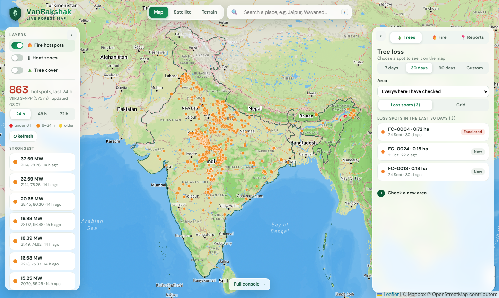

## Real examples from the app

All three pictures come from the running app, using real satellite imagery. Nothing is mocked up.

| Deforestation | Wildfire | Afforestation |
|---|---|---|
|  | 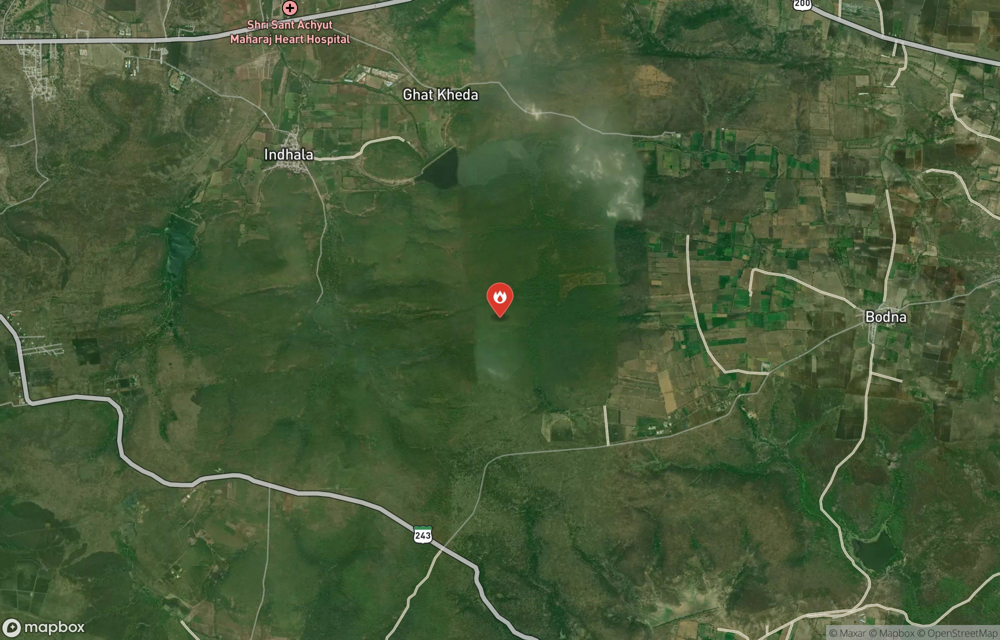 | 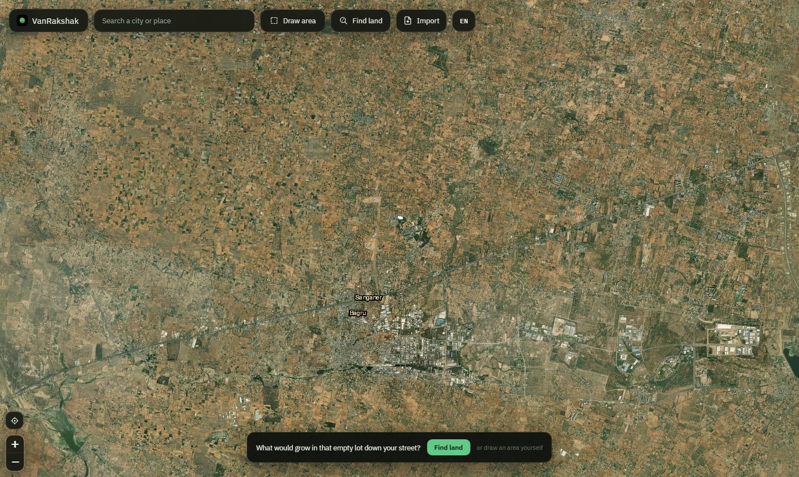 |
| **Tree loss near Wayanad, Kerala.** The red area is 0.72 ha of tree cover that Sentinel-2 and Sentinel-1 show was lost in the last 30 days. | **Fire near Amravati, Maharashtra** (VF-002, NASA VIIRS, 329 MW). The pin is the satellite hotspot; the smoke plume is visible on the imagery. | **Replanting intelligence.** Draw an area or find empty land, and get species and growth suggestions for restoring it. |

### Deforestation: the polygon shrinks over 90 days

For every spot, the tree-cover polygon is shown as it was 90, 30 and 7 days ago and today, with a slider and a Play button. The red patches are tree cover that was lost; the dashed outline is the cover 90 days ago.

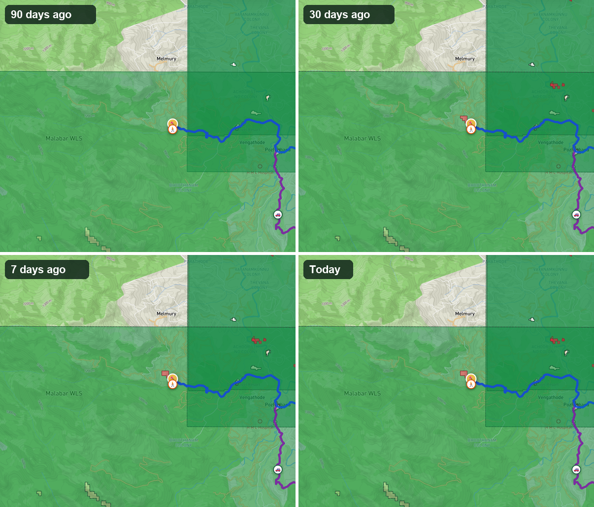

### Wildfire: where the fire could spread

For a fire incident, VanRakshak shows a **predicted spread footprint** at 3, 6 and 12 hours from wind, temperature, humidity, drought and slope. Red is the area that most model runs burn (50% or more), orange is possible (10% or more). It is a risk footprint, not a fire perimeter.

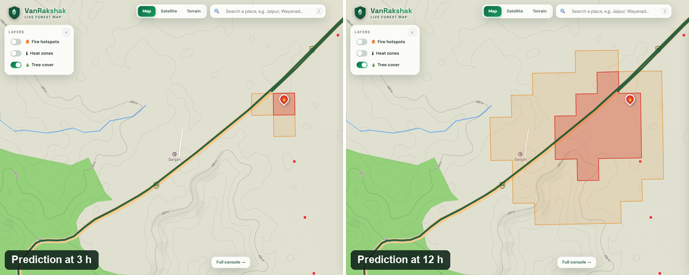

### Afforestation: what to plant and how it grows

The Replanting intelligence workspace takes an area you draw and lists native species that suit it, then shows how a chosen species would grow over the years on the map.

| Draw an area, get species that suit it | Pick one and slide through the years |
|---|---|
| 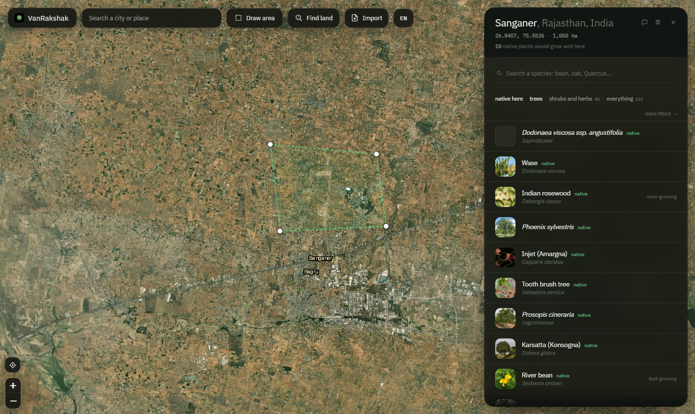 | 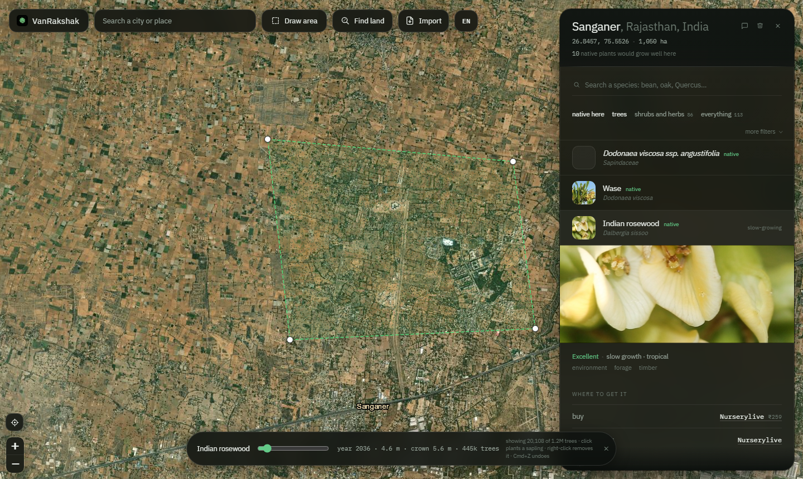 |

## What it does, in one picture

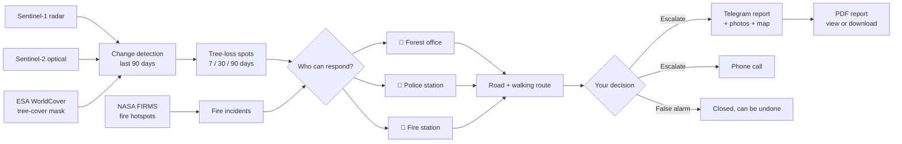

## Start here

```powershell
cd "E:\Project 2\VanRakshak"
python -m venv .venv
.venv\Scripts\activate
pip install -r requirements.txt
copy .env.example .env        # then add the keys you have (see below)
uvicorn app.main:app --port 8000
```

Open <http://localhost:8000> to go directly to the live map. The integrated **Replanting intelligence** workspace is at `/replanting/`. The full console is at `/app`, API docs at `/docs`.

## The live map

The map starts clear. Nothing is drawn until you switch a layer on or choose an incident. Type the first letters of any place in the search box to get suggestions and jump straight there.

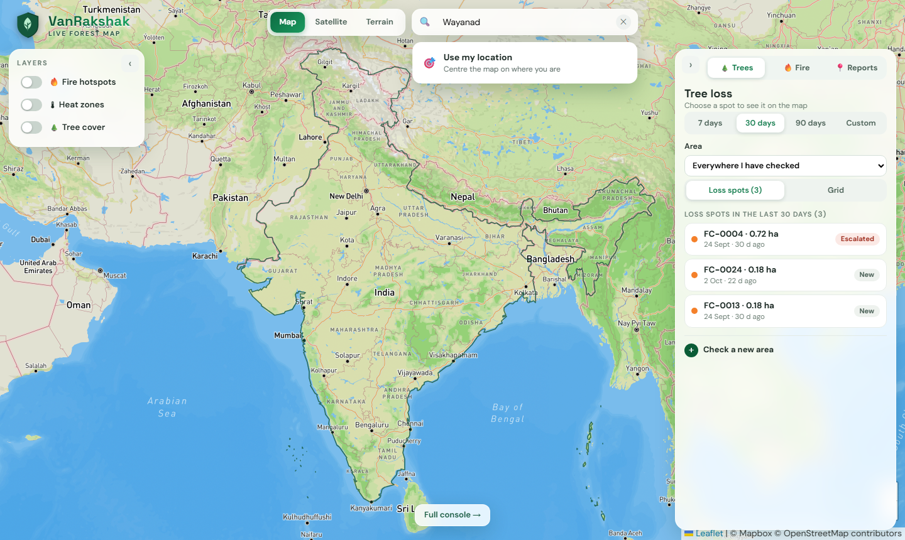

| Where | What it does |
|---|---|
| **Left: Layers** | Switch on **NASA fire hotspots**, **Heat zones** or **Tree cover**. Map, Satellite and Terrain views at the top. |
| **🌲 Trees** | Pick 7 / 30 / 90 days or a custom range. **Check a new area**: draw a rectangle or any shape anywhere in India. A drawn area is cut into labelled grid cells with loss for 7, 30 and 90 days. Tree cover is shown as polygons that shrink over 90 → 30 → 7 days → today. |
| **🔥 Fire** | **Happening now** (live incidents) and **Past fires**: real fires from NASA's archive to look at between live fires. Choosing one shows the spread footprint and the route from the nearest station. |
| **📍 Reports** | **Check a factory** (place it, fill in details or upload its PDF, see the effect on forest, air, water and people today and after 7 / 30 / 90 days), incidents you mark by hand, and worked **case studies**. |

### A tree-loss spot: who can respond, and how to get there

Open a spot and VanRakshak finds the nearest **forest offices, police stations and fire station** from OpenStreetMap and Google Maps (SerpAPI), works out the road route and a walking leg for the last stretch, and lists them by travel time. Tap one to show its route on the map, tap again to hide it. The nearest police station is always shown beside the main responder for an immediate response.

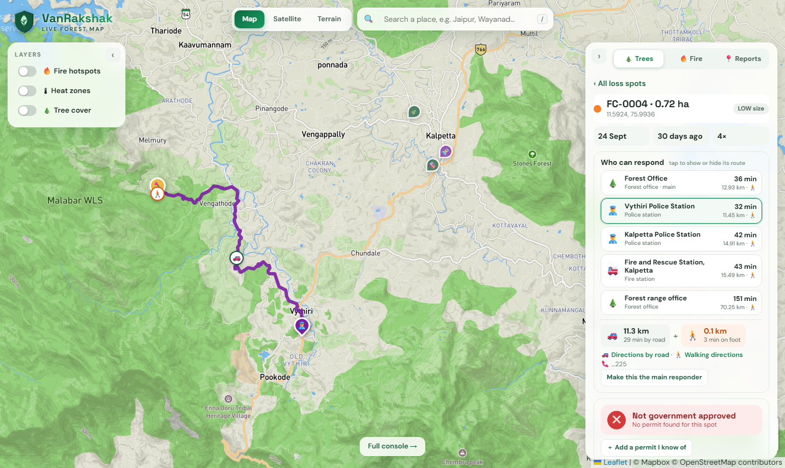

Every route is split into 🚗 **road** and 🚶 **on foot** parts, so a forest track that roads do not reach is not hidden.

The permit box answers one question: **Government approved** or **Not government approved** (against the permits loaded or entered in the system; no live government permit API exists).

### New construction: what was built in the last 365 days

Switch on **🏗 New construction** (or open the **🏗 Built** tab). Pick a ready-made Jaipur area or draw your own patch anywhere in India, and VanRakshak compares real Sentinel-2 pictures from a year ago and now. Every new road, highway, building, industrial area, construction site, quarry or cleared plot is drawn as a polygon, coloured by type, with its impact, a drag-to-compare before / after picture, and a PDF report for each change and for the whole check. A detection you do not believe can be set aside and put back. Details: [docs/INFRA_CHANGE.md](docs/INFRA_CHANGE.md).

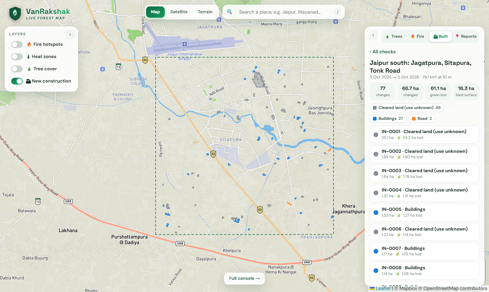

Open any change to drag between **a year ago** and **now**. This 25 ha patch was dense greenery in October 2025 and is a cleared, laid-out plot in October 2026:

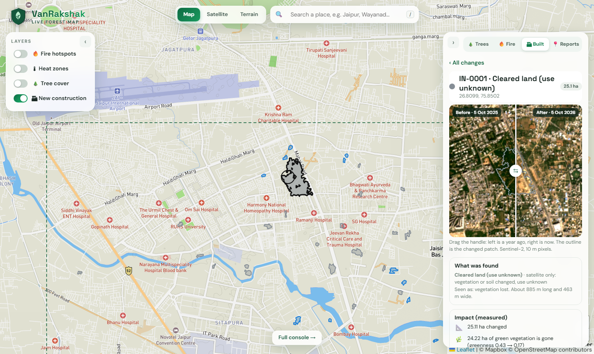

Each change, and the whole check, has a report with the pictures, the impact and clickable map links:

| One change | The whole check |
|---|---|
| 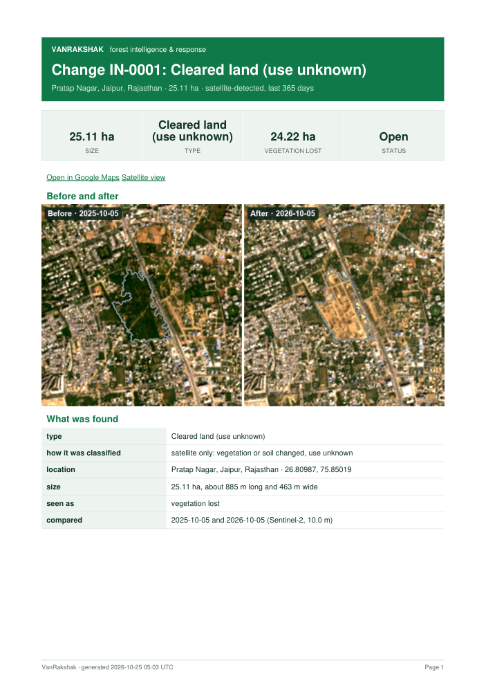 | 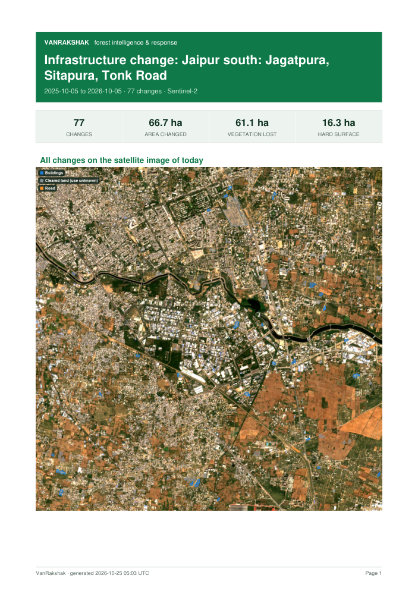 |

### 3D simulation of an incident

Every incident (a reported incident, a fire, or a tree-loss spot) has an **Open in Forest Explorer** button. It opens a **simulated** 3D forest inside the incident's exact boundary, where you can play a deforestation, a fire-spread (with wind) or a combined scenario. It is clearly labelled as invented: not real mapping, not satellite evidence, not a forecast. Details: [docs/FOREST_SIMULATION.md](docs/FOREST_SIMULATION.md).

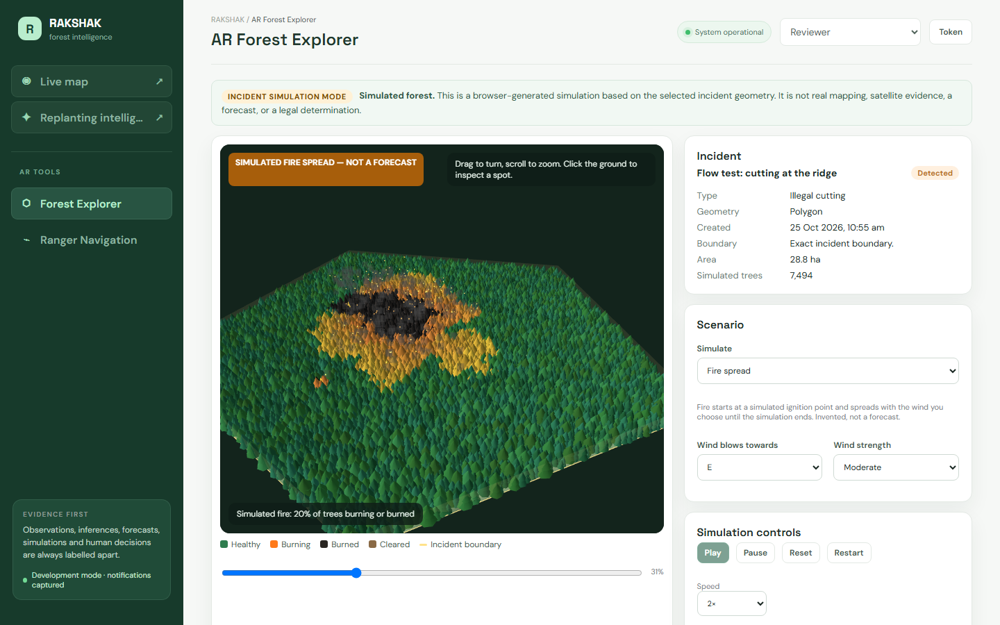

### Ranger AR navigation on a phone

Every incident has an **Open Ranger AR Navigation** button (live map and Investigations). It opens the incident's real polygon (or a marker for a point), the recommended and alternative routes from the nearest station (🚗 road, 🚶 walking), and a **QR code** headed "Open on ranger phone".

Scan it and the phone opens a guidance page: camera behind a large arrow, distance and bearing to the incident, GPS accuracy, route progress, off-route warnings and a Recalculate button. If the camera, compass or GPS is refused, the page says so and still guides. The link is signed, expires in about 45 minutes and carries only the incident and the expiry, no password. Only the latest position is kept, and it is deleted when the ranger exits. It is guidance only and can be wrong under canopy.

**To use it on a phone** (same Wi-Fi as the computer):

```powershell
# once, as Administrator: let phones reach the computer
New-NetFirewallRule -DisplayName "VanRakshak phone" -Direction Inbound -Protocol TCP -LocalPort 8000,8443 -Action Allow -Profile Any
# phones only allow the camera and location on HTTPS, so start the HTTPS server
python scripts/run_phone_https.py
```

Open the printed `https://<computer address>:8443/live` on the phone once and choose Advanced, then Continue (the certificate is self-made, kept in `data/certs/`, and never committed). QR codes made after that use this address. To use a public HTTPS tunnel instead, set `MOBILE_PUBLIC_BASE_URL`.

### One decision: Escalate or False alarm

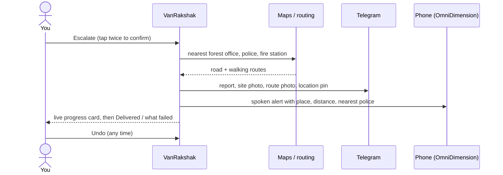

### Fire incidents

Fires come from NASA hotspots (click a hotspot, then Investigate). **Past fires** adds up to ten real India fires from NASA's archive so there is always something to look at.

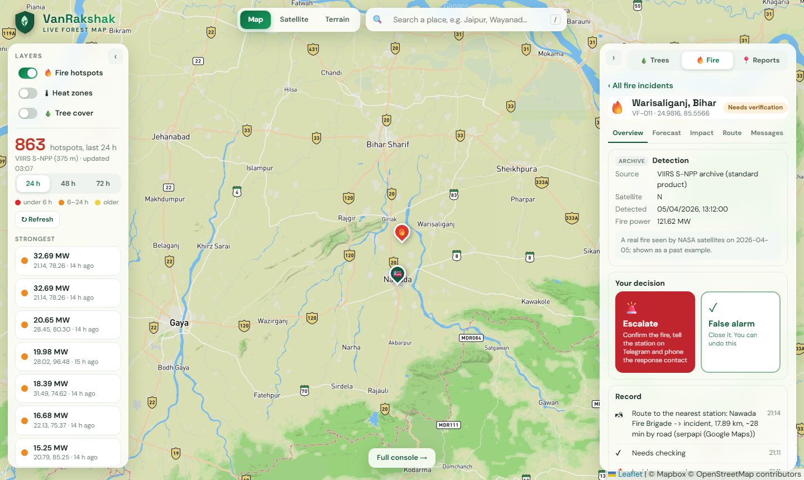

## Telegram reports and PDF

The Telegram message is a short, sectioned report: what and how much, exactly where (place name, coordinates, Google Maps and satellite links), when, permit status, the forest office or police station to go from with directions, the nearest police station, and what to do. It is followed by two pictures and the location pin.

| The lost area (red) | Routes from the responders |
|---|---|
| 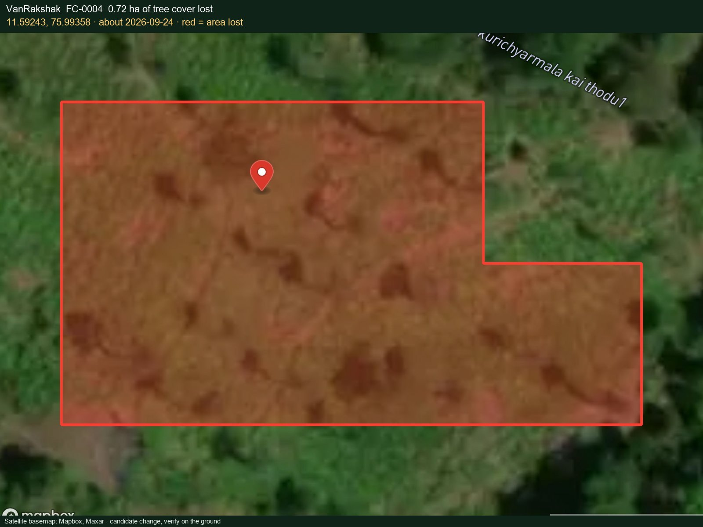 | 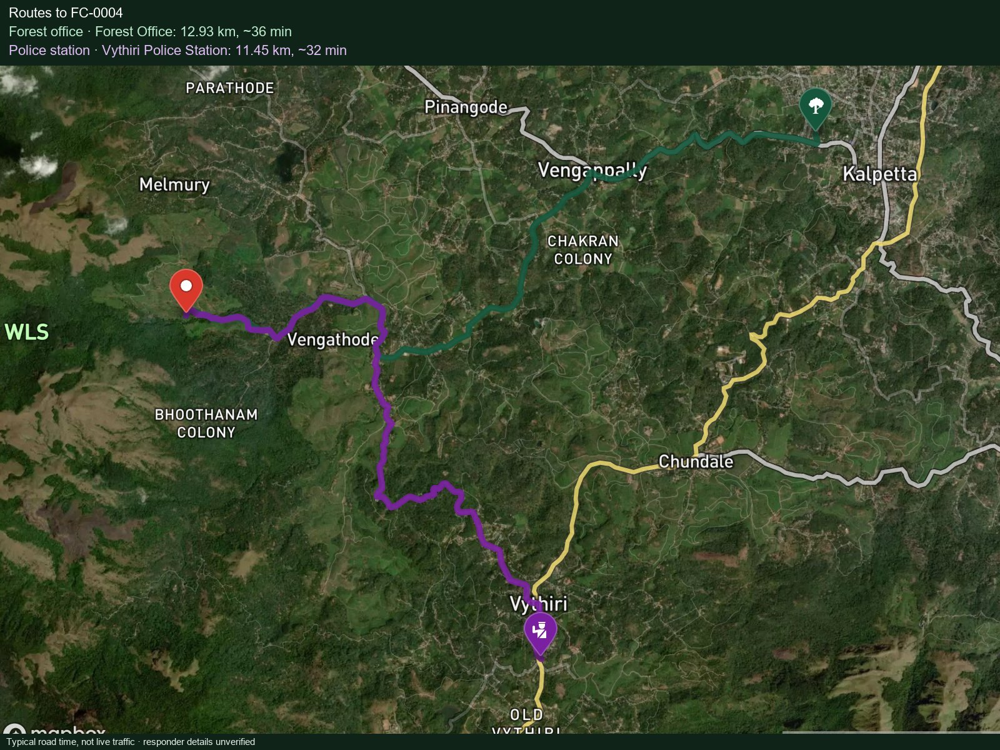 |

Each spot also has a **report** you can **view in the page or download**: summary, live satellite pictures, map, routes, permit result, responders and clickable links.

| Page 1 | Page 2 |
|---|---|
| 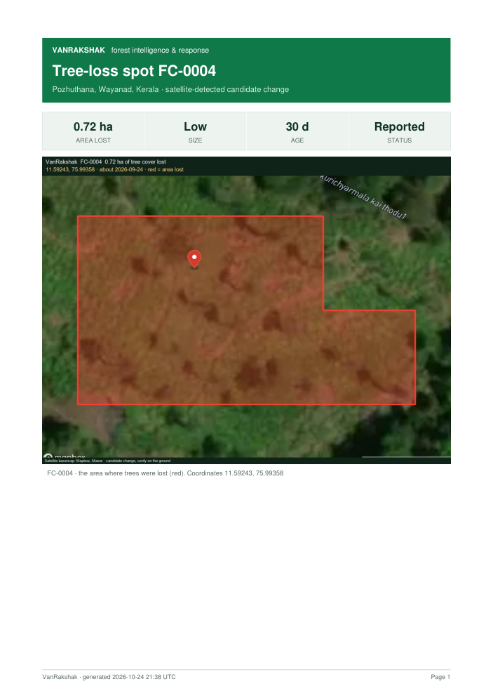 | 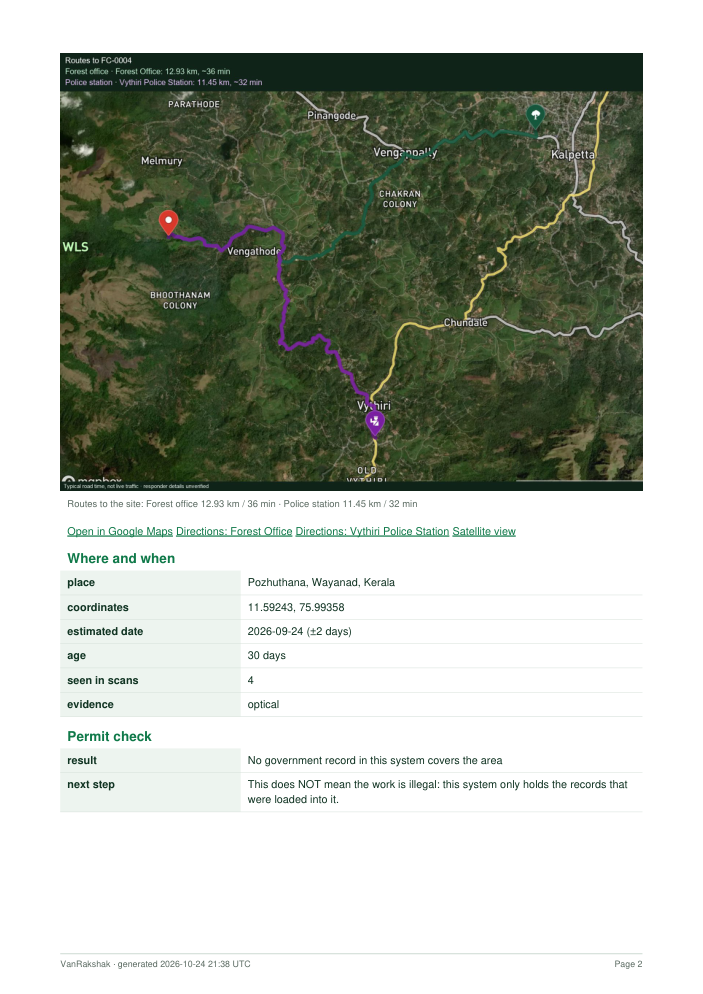 |

## How the data flows

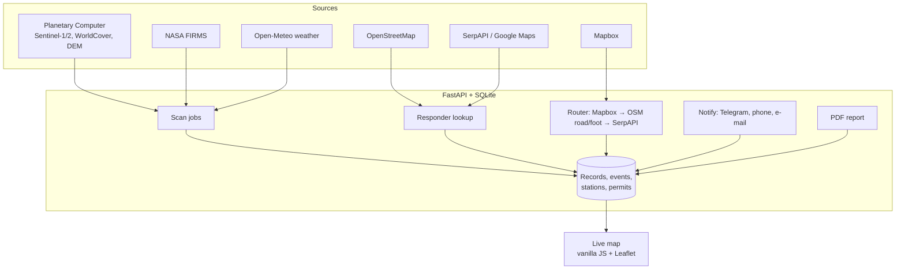

## Keys (`.env`)

Never commit `.env` (it is in `.gitignore`).

| Variable | Purpose |
|---|---|
| none needed | Sentinel-1/2, WorldCover, elevation: Microsoft Planetary Computer is public |
| `FIRMS_API_KEY` | NASA active-fire hotspots (free MAP_KEY) |
| `MAPBOX_API` | Road and walking routing, the base map and report pictures. Use a public `pk.` token (it is sent to the browser). If Mapbox refuses the token, the app falls back to free OpenStreetMap layers and routers |
| `SERP_API` | Forest-office, police-station and fire-station lookup, routing fallback (free plan: 250 searches a month) |
| `TELEGRAM_BOT_TOKEN`, `TELEGRAM_CHAT_ID` | Telegram alerts |
| `IVR_PROVIDER=omnidimension`, `OMNIDIM_API_KEY`, `OMNIDIM_AGENT_ID`, `IVR_RESPONSE_NUMBER` | Phone calls through OmniDimension. The agent must be set up to read the `message` it is given |
| `SMTP_*`, `FOREST_ALERT_EMAIL_TO` | E-mail alerts (optional) |
| `MOBILE_PUBLIC_BASE_URL`, `MOBILE_LINK_SECRET`, `MOBILE_LINK_MINUTES` | Phone QR links: the address a phone can reach (default: this computer's network address), the signing key, and how long a link works (default 45) |

Restart the server after editing `.env`. Real messages and calls are only sent after an explicit confirmation in the interface.

## What is verified, and what is not

| Area | Status |
|---|---|
| Sentinel-2 + Sentinel-1 acquisition, cloud masking, forest mask, 90-day change detection with loss dates and uncertainty | Live-verified on a real forest block |
| Monthly alert engine (two-observation confirmation, seasonal baseline, optical + radar fusion) | Implemented and tested; accuracy not validated against ground truth (see [docs/MONTHLY_ALERTS.md](docs/MONTHLY_ALERTS.md)) |
| NASA FIRMS hotspots and archive, Open-Meteo weather | Live-verified |
| Mapbox, OpenStreetMap and SerpAPI routing; responder lookup | Live-verified |
| Fire spread forecast (3 / 6 / 12 h) | Prototype model, not validated for Indian forests; shows a risk footprint, not a fire perimeter |
| Responders (forest offices, police, fire stations) | Public map data; jurisdiction, availability and phone numbers are **unverified** |
| Telegram alerts | Built and gated; use a real send only when you intend to |
| Phone calls (OmniDimension / Twilio) | Built against the providers' documented APIs; check with your own account |
| Permit check | Compares against records loaded in the system; "no record found" does not mean illegal |
| Case studies | Illustrative worked examples, not records of real companies |

Not done: PostGIS, Celery/Redis, trained deep-learning models, PARIVESH integration, biodiversity data, native AR app. See [docs/LIMITATIONS.md](docs/LIMITATIONS.md).

## Tests

```powershell
python -m pytest -q             # unit, API, safety and browser tests
python -m pytest tests/e2e -q   # browser tests only (needs Playwright and Chrome)
```

Tests use a temporary database, blank every provider key and switch the public routers off, so they cannot spend quota or send messages.

## Docs

[Forest change](docs/FOREST_CHANGE.md) · [New construction](docs/INFRA_CHANGE.md) · [3D simulation](docs/FOREST_SIMULATION.md) · [Ranger AR navigation](#ranger-ar-navigation-on-a-phone) · [Fire response](docs/FIRE_RESPONSE.md) · [Factory check](docs/FACTORY_CHECK.md) · [Monthly alerts](docs/MONTHLY_ALERTS.md) · [Architecture](docs/ARCHITECTURE.md) · [API reference](docs/API_REFERENCE.md) · [AR](docs/AR.md) · [Data sources](docs/DATA_SOURCES.md) · [Security](docs/SECURITY.md) · [Deployment](docs/DEPLOYMENT.md) · [Limitations](docs/LIMITATIONS.md)
